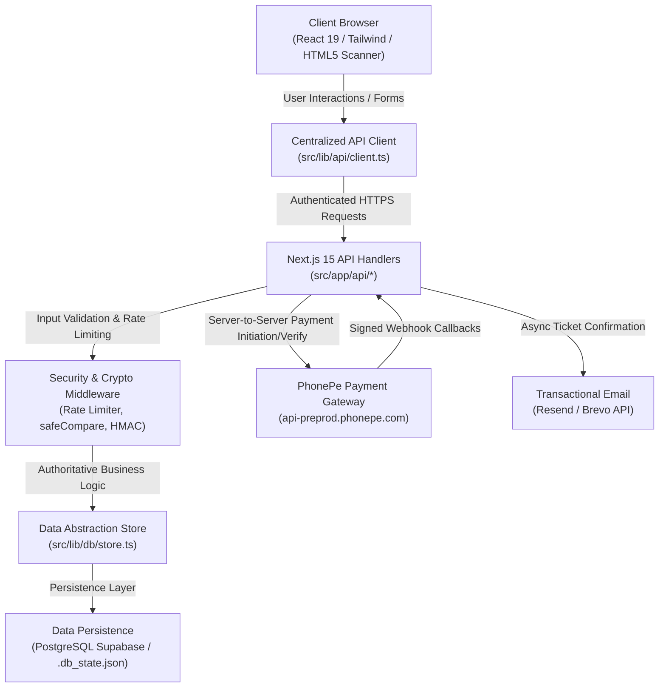

# RAAS IN TAAL — SYSTEM ARCHITECTURE SPECIFICATION

**Event:** Raas in Taal 2026 — A Dandiya Night by Chaos and Chill  
**Date & Venue:** Sunday, 18 October 2026 • Khelcity Multi-Sports Arena, Jagatpura, Jaipur  
**Stack:** Next.js 15 (App Router), React 19, TypeScript, Tailwind CSS, Node.js Crypto, PhonePe PG, Supabase / Zero-dependency DB store.

---

## 1. System Overview & Runtime Architecture

Raas in Taal operates as a unified, full-stack Next.js 15 application utilizing the App Router architecture. The system combines modern server-side rendering, streaming client components, serverless/edge-ready API route handlers, and a dual-tier storage abstraction.



---

## 2. Component Boundaries & Responsibilities

### A. Frontend Layer (`src/app/` & `src/components/`)
- **Homepage (`src/app/page.tsx`):** Heritage-inspired dark maroon/gold cultural aesthetic with photography, countdown timer, event schedule, rules & guidelines, and ticket tier cards.
- **Checkout (`src/app/checkout/page.tsx`):** Streamlined checkout with instant attendee details entry (Full Name, Email, Mobile, Attendee Names). Automatically links to customer account if signed in or registers booking directly. Validates attendee details and minimum female requirements for group bookings.
- **Account & My Tickets (`src/app/account/page.tsx`, `src/app/my-tickets/page.tsx`):** Customer dashboard showing confirmed bookings, QR passes, and ticket resend actions.
- **Booking Status (`src/app/booking/[id]/page.tsx`):** Displays real-time payment status, countdown for pending reservations, and download/print buttons.
- **Ticket Pass View (`src/app/ticket/[token]/page.tsx`):** Publicly verifiable mobile pass view for gate entry with dynamic QR code.
- **Staff Gate Scanner (`src/app/scanner/page.tsx`):** In-browser HTML5 camera QR scanner for gate staff. Enforces PIN verification, live audio/haptic feedback, and partial admittance controls.
- **Admin Dashboard (`src/app/admin/page.tsx`):** Financial stats, live capacity tracking, attendee check-in progress, ticket revocation, and manual pass issuance.

### B. API Routing Layer (`src/app/api/`)
- `/api/auth/*`: Customer registration, login, session inspection (`/me`), and logout using signed HMAC session cookies.
- `/api/orders`: Authoritative booking creation, server-side price calculation, capacity validation, and temporary reservation holding.
- `/api/payments/verify`: Server-to-server PhonePe transaction verification, payment confirmation, and idempotent ticket issuance.
- `/api/webhooks/phonepe`: Official PhonePe webhook callback receiver with X-VERIFY checksum validation.
- `/api/scanner/check-in`: Rate-limited, timing-safe staff QR validation and attendee check-in.
- `/api/tickets/resend`: Triggers ticket email re-dispatch.
- `/api/admin/stats` & `/api/admin/action`: Protected administrative endpoints.

### C. Core Services (`src/lib/`)
1. **`src/lib/api/client.ts`:** Centralized client for frontend-to-backend communication, supporting custom base URLs via `NEXT_PUBLIC_API_BASE_URL`.
2. **`src/lib/security/crypto.ts`:**
   - `generateSecureToken()`: Generates 256-bit CSPRNG base64url tokens.
   - `hashToken()`: Computes SHA-256 hex hash for stored token lookup.
   - `safeCompare()`: Constant-time comparison using `crypto.timingSafeEqual`.
   - `createSessionToken()` / `verifySessionToken()`: Cryptographically signed HMAC sessions.
   - `checkRateLimit()`: In-memory sliding-window request throttling.
3. **`src/lib/payments/phonepe.ts`:** Authoritative PhonePe payment payload generation, X-VERIFY SHA-256 checksum calculation, and callback signature verification.
4. **`src/lib/db/store.ts`:** Unified storage adapter. Automatically falls back to resilient `.db_state.json` when Supabase credentials are not present.
5. **`src/lib/email/service.ts`:** Multi-provider transactional email service with fallback mock mode for local development.

---

## 3. End-to-End Data Flow

```
[1. User selects Ticket]
       │
       ▼
[2. Frontend POST /api/orders]
       │
       ├─► Check Capacity (max 500 attendees)
       ├─► Check Rules (Group: 1 female mandatory; Couple: male + female)
       ├─► Server calculates amountPaise (ignoring client prices)
       └─► Creates order in 'PENDING' state with 10-minute expiry
       │
       ▼
[3. User redirected to PhonePe Gateway]
       │
       ▼
[4. Payment Success Callback]
       │
       ├─► PhonePe redirects to /booking/{orderReference}
       ├─► /api/payments/verify checks transaction with PhonePe Server
       ├─► Status transitions to 'PAID'
       ├─► Exactly 1 QR Gate Pass generated (256-bit entropy)
       └─► Async confirmation email dispatched via Resend
       │
       ▼
[5. Event Day Gate Entry]
       │
       ├─► Gate staff scans QR at /scanner
       ├─► POST /api/scanner/check-in verified with Staff PIN (timing-safe)
       ├─► Token verified against active passes (rejects UNPAID/REFUNDED/REVOKED)
       └─► Entry allowance deducted atomically (supports partial group arrival)
```
